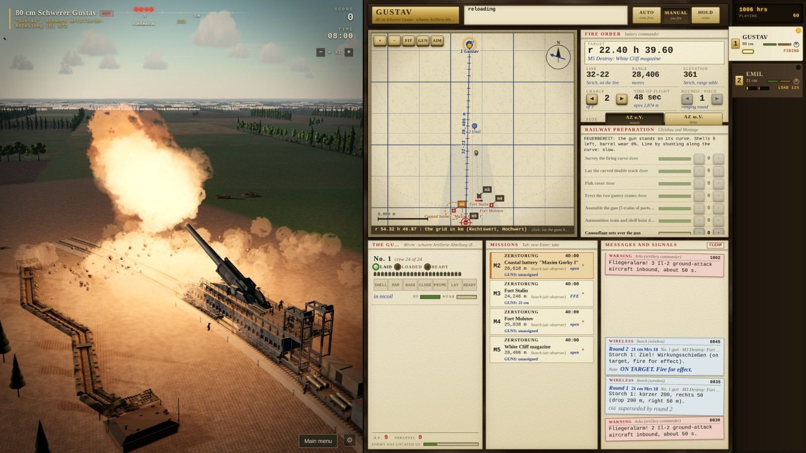

# Drumfire: heavy artillery, 1917 to 1944



**Command heavy artillery from a fire control console: British guns at Ypres in 1917, a German Gruppe on the same ridge in 1918, and German guns and special weapons of the Second World War.**

**Why it's different:** you lay the guns from a map and a range table and correct from the observers' reports while the enemy's guns hunt yours. History gives the guns, places, words and procedures; ranges, loading times and damage are game rules.

## What you do

- **Fire missions.** Observers, aircraft and sound rangers call in targets. Lay the guns from the map, fire a ranging round, correct, then fire for effect.
- **Counter-battery and SOS.** Firing gives your guns away and enemy fire walks onto them. When the enemy's infantry attack, SOS puts every gun that can reach on their line.
- **Three eras.** 1917 British heavies; WW1 German in 1918, with the Paris Gun; WW2 German, with the Gustav, the Karl-Gerät, the V-1 and the V-2.
- **Research and upgrades.** In 1917 and WW2 you start with one gun. Every battle pays research points for new batteries and battery points for more guns and better shells, barrels, breeches and sights.
- **Tutorials.** Six guided lessons each for 1917 and WW2.
- **Serve a gun in person.** Take each man's place in turn at a WW2 gun, from the field howitzers to the Gustav and the Karl-Gerät, or on the Big Bertha demo's 42 cm howitzer.

## Play it

```bash
npm install
npm run dev      # then open http://localhost:5201
```

You need a browser with WebGL2 and graphics acceleration on. To share it, run `npm run build` and serve `dist/` from any folder of a web server (not `file://`); for itch.io, zip the contents of `dist/` and upload it as an HTML game. Details: [docs/DEVELOPMENT.md](docs/DEVELOPMENT.md).

## Controls

| Key | Action |
|---|---|
| 1 to 9 | select a unit |
| P | WW2: man the selected battery's gun in first person (1 to 4 the posts, E the work) |
| Mouse drag, wheel | orbit and zoom the camera |
| Tab, Enter | move to a mission and take it |
| Space | fire |
| Arrow keys | correct the aim: up adds range, down drops, left and right shift the line |
| `.` | apply the correction from the newest observer report |
| S | SOS: every gun that can reach lays on the threatened sector |
| F | ride the newest shell to its burst; F again returns to the gun |
| `[` and `]` | slow down or speed up time (x0.25 to x8) |

Every key, including the special weapons': [docs/PLAYING.md](docs/PLAYING.md#controls).

## Status

**Playable:** all three eras, research and upgrades, both campaigns, twelve lessons and the Big Bertha demo. The Gustav, the Paris Gun and the demo are work in progress (marked WIP).

**Not done yet:**

- Lessons for the WW1 German era.
- Playtesting the research pace, the upgrades and the campaigns' difficulty.
- Relaying Bertha's or the Gamma's bed is instant; the 100 s it took is to come back.
- Planned for WW2: V-1 and V-2 skill moments, V-2 shoot and scoot, the Karl's crew on the move.
- Three of the Paris Gun's four target effects are inactive.

Full list: [docs/DEVELOPMENT.md](docs/DEVELOPMENT.md#not-done-yet).

## Go deeper

- **[How to play](docs/PLAYING.md):** every era, unit, drill, key and lesson.
- **[What's modelled](docs/MODELLED.md):** rendering, simulation and sound.
- **[History and sources](docs/HISTORY.md):** what is real and what is game; the long versions are [docs/WW1.md](docs/WW1.md) and [docs/WW2.md](docs/WW2.md).
- **[Development](docs/DEVELOPMENT.md):** tests, tools, URL parameters, dev pages and the source layout.
- **[DESIGN.md](DESIGN.md):** the contract between the modules.

## More games

- [Battle Stations](https://github.com/drichards188/battlestations): man the anti-aircraft guns of USS Alabama in the Pacific, 1944.
- [Echelon](https://github.com/drichards188/echelon): command a layered air defense, from today's missile systems to the German flak of 1945.

## Credits

- **Libraries:** [three.js](https://threejs.org) and [lil-gui](https://lil-gui.georgealways.com); [Vite](https://vite.dev) and [playwright-core](https://playwright.dev) for development.
- **Recordings:** eight recordings from Freesound, seven CC0 and one CC BY 4.0: ["Tykki, laukaus / Big gun, cannon, 76 mm, single shots, gunshots"](https://freesound.org/s/332935/) by YleArkisto ([CC BY 4.0](https://creativecommons.org/licenses/by/4.0/)); sources in [public/audio/CREDITS.md](public/audio/CREDITS.md).
- **Voices:** the WW2 and WW1 German crews' callouts are synthetic speech made with [Piper](https://github.com/OHF-Voice/piper1-gpl): the `de_DE-mls-medium` voice, trained on Multilingual LibriSpeech by Pratap et al. ([CC BY 4.0](https://creativecommons.org/licenses/by/4.0/)), and `de_DE-thorsten_emotional-medium` (Thorsten-Voice, CC0); details and a licence note in [public/audio/CREDITS.md](public/audio/CREDITS.md).
- **Reference photos:** mostly from Wikimedia Commons, used only locally to check the models.

**Licence:** © 2026 David Richards. Drumfire is source-available under [PolyForm Strict 1.0.0](LICENSE): you may play and study it for non-commercial purposes, but not copy, change or publish your own version of it, or use it commercially. Contributions are welcome here; see [Contributing](CONTRIBUTING.md). The libraries and recordings above keep their own licences.
